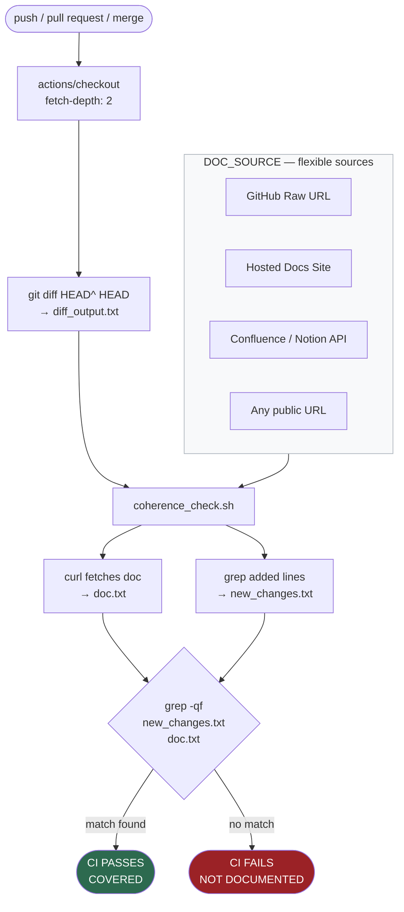

# Code-Doc Coherence CI

A GitHub Actions workflow that automatically checks whether code changes are reflected in the project documentation. It fails the CI pipeline if new code additions are not mentioned in the docs.

---

## Workflow Diagram



---

## How It Works

1. **Capture the diff** — on every push or pull request, the workflow runs `git diff HEAD^ HEAD` and saves the output to a file
2. **Extract added lines** — the bash script filters only added lines (starting with `+`) from the diff
3. **Fetch documentation** — the script fetches the documentation from a configured URL using `curl`
4. **Compare** — `grep -f` checks if any of the added lines appear in the documentation
5. **Pass or Fail** — exits with `0` (covered) or `1` (not documented), which passes or fails the CI job

---

## Workflow Structure

```
Code-Doc Coherence CI/
├── coherence_check.yaml   # GitHub Actions workflow
└── coherence_check.sh     # Bash script that does the comparison
```

### `coherence_check.yaml`
Defines the CI pipeline with three steps:
- Save the git diff to `diff_output.txt`
- Make the script executable (`chmod +x`)
- Run the script passing the doc source URL and diff file

### `coherence_check.sh`
Accepts two arguments:
```bash
./coherence_check.sh <DOC_SOURCE_URL> <DIFF_FILE>
```
- `DOC_SOURCE_URL` — URL of the documentation to fetch
- `DIFF_FILE` — path to the saved git diff output

---

## Setup

### 1. Add the workflow to your repository
Place `coherence_check.yaml` inside `.github/workflows/` in your repository.

### 2. Set the `DOC_SOURCE` variable
In your GitHub repository go to:
> Settings → Secrets and variables → Actions → Variables

Add a variable named `DOC_SOURCE` with the URL of your documentation source (e.g., a hosted markdown file, a docs site, or a raw GitHub URL).

### 3. Add the script
Place `coherence_check.sh` in the root of your repository.

---

## Use Cases

- **API documentation** — ensure that new endpoints or functions added to the code are mentioned in the API docs
- **Onboarding docs** — catch when new modules or services are added but never documented for new team members
- **Changelog enforcement** — verify that code changes have a corresponding entry in a changelog or release notes
- **Architecture docs** — flag when new classes or files are introduced without updating architecture documentation

---

## Things to Consider

### What it checks
- It checks **added lines only** (`+` in the diff), not modified or deleted lines
- Each added line is searched as a pattern — a match is found if any part of the added line appears anywhere in the documentation text
- It does **not** understand semantics — it is a text presence check

### False positives
- A line of code may match a doc line coincidentally (e.g., a common word like `return` or `true`)
- Consider the nature of your codebase — highly generic code may trigger false positives

### False negatives
- Documentation may describe a function using different wording than the code (e.g., `processPayment` in code vs "payment processing" in docs)
- The check will pass even if the doc reference is stale or incorrect — it only checks for presence make sure to add the same function name in the doc

### Deleted code
- The workflow does **not** check if deleted code is still referenced in the docs, which can leave stale documentation behind
- Consider adding a separate step to check removed lines (`-` in diff) against the docs

### Documentation source
- The `DOC_SOURCE` must be a publicly accessible URL or a URL accessible from the GitHub Actions runner
- If your docs are private, you may need to pass an auth token to `curl` in the script

---

## CI Output Examples:

**When covered:**
```
=== Checking changes against doc ===
COVERED
```

**When not documented:**
```
=== Checking changes against doc ===
NOT DOCUMENTED: check out your code-documentation coherence in your new added changes
```